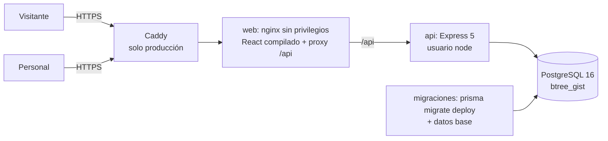

# Arquitectura

## Componentes

- **Un solo origen.** El navegador llama a `/api` en el mismo dominio, sin CORS entre dominios ni cookies. La sesión va en `Authorization: Bearer`.
- **Monolito modular.** La API se organiza por capas: `routes` (validar, autorizar, llamar), `services` (reglas y transacciones), `domain` (funciones puras) y `schemas` (Zod).
- **Migraciones aparte.** Un servicio de un solo uso aplica las migraciones con el rol dueño, crea o actualiza el rol de mínimo privilegio de la API (`backend/scripts/rol-aplicacion.ts`) y carga los datos base. La API no migra al arrancar y no puede cambiar tablas.

## Modelo de datos

| Entidad (tabla) | Campos clave | Relaciones y reglas |
|---|---|---|
| `usuarios` | email único en minúsculas, `password_hash` (argon2id), `version_token`, activo | rol |
| `roles`, `permisos`, `rol_permisos` | código | Permisos `recurso:accion` configurables por rol |
| `tipos_habitacion` | nombre único, publicado, activo | Habitaciones, preferencia de reservas |
| `canales` | código (`web` protegido) | Origen de cada reserva |
| `ajustes` | clave, `valor` JSONB, confirmado, publicado | `CHECK (NOT publicado OR confirmado)` |
| `habitaciones` | número único entre activas, capacidad, activa | Camas y bloqueos. Se retiran, no se borran |
| `camas` | identificador único por habitación activa, tipo, plazas (1 a 4), activa | Ocupaciones |
| `bloqueos` | tipo (BLOQUEO, MANTENIMIENTO), habitación, cama opcional, `[fecha_inicio, fecha_fin)` (fin opcional), motivo, quién creó y liberó | Crea ocupaciones en cada cama afectada |
| `ocupaciones_cama` | cama, tipo (RESERVA o BLOQUEO), reserva o bloqueo, `[fecha_inicio, fecha_fin)`, activa | **EXCLUDE**: sin cruces activos por cama |
| `huespedes` | nombres, apellidos, teléfono, correo, documento opcional, consentimiento, `anonimizado_en` | Reservas |
| `reservas` | número legible (HR-00042), estado, fechas DATE, cantidad de huéspedes, canal, responsable, clave de idempotencia y huella | `CHECK` de fechas, cancelación coherente |
| `auditoria` | usuario, acción, entidad, id, datos mínimos | Inmutable por *trigger* |
| `limites_tasa` | clave, hits, reinicio | Rate limit persistente |

## Cómo se evita la sobreventa

1. Cada noche tomada de una cama es una fila en `ocupaciones_cama`, tanto para reservas como para bloqueos.
2. PostgreSQL impide dos filas **activas** de la misma cama con noches en común:
   `EXCLUDE USING gist (cama_id WITH =, daterange(fecha_inicio, fecha_fin, '[)') WITH &&) WHERE (activa)`.
3. Crear, mover o asignar ocupaciones ocurre dentro de una transacción. Si otra transacción tomó la cama primero, PostgreSQL rechaza la segunda (SQLSTATE 23P01), la transacción se revierte completa, sin reserva ni huésped huérfanos, y la API responde **409 `CAMA_NO_DISPONIBLE`** con el detalle de la cama y el código de la reserva que la ocupa.
4. Los cambios sobre una misma reserva (estado, fechas, camas) bloquean su fila con `SELECT … FOR UPDATE` y los cambios de estado usan `updateMany where estado = actual`.

Las pruebas de `backend/test/integration/concurrencia.test.ts` lanzan 10 reservas simultáneas por la misma cama: exactamente una gana.

## Endpoints principales

Ver [API.md](API.md) y Swagger en `/api/docs`.

## Autenticación y roles

- `POST /api/auth/login` entrega un JWT HS256 de corta duración (2 horas por defecto, configurable) con `ver` (versión de token).
- Cada petición del panel recarga el usuario y sus permisos: desactivar a alguien o cambiar su rol aplica de inmediato.
- Permisos: `tablero:ver`, `reservas:ver|gestionar|cancelar`, `habitaciones:ver|gestionar`, `bloqueos:gestionar`, `huespedes:ver|ver_documento|gestionar_datos`, `configuracion:gestionar`, `usuarios:gestionar`, `auditoria:ver`.
